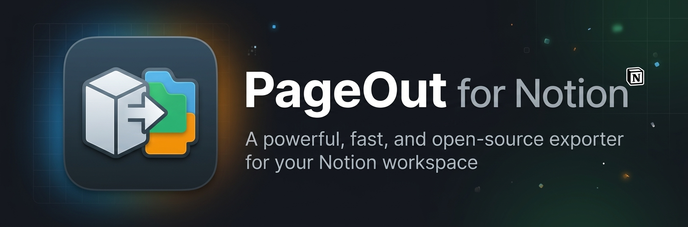

<p align="center">
  
</p>


# PageOut for Notion

**Export your beautiful Notion pages to PDF, HTML, Markdown, Word, and more** — with full control over styling, images, and formatting. Available as a desktop app **or** command-line tool.

> **Version 1.0.0-rc.1 (Release Candidate)** — everything is working and tested! Just needs a final checklist before the official 1.0.0 release.

---

## 👋 Welcome!

Whether you're a Notion power user, a student, a writer, or just someone who loves beautiful documents, PageOut helps you get your Notion content out into the world — exactly how you want it.

**Your data is always safe with us.** PageOut only reads your Notion content; nothing gets modified. And don't worry about secrets — they're handled securely with your OS's keyring whenever possible.

---

## Key Features

| What you get | Details |
|-------------|---------|
| **Multiple formats** | PDF, HTML, Markdown, Text, Word (.docx), JSON, LaTeX (.tex), and raw images |
| **Beautiful output** | Clean layouts, math rendering, code highlighting, callouts, and more |
| **Smart image handling** | Embed, save locally, or link to images. Customize filenames and captions! |
| **Great for writers** | Page numbers, covers, headers, custom fonts, line spacing, and alignment |
| **Works offline** | Export from Notion's .zip files — no token required |
| **Powerful CLI** | Automate with simple commands or config files |

---

## Quick Start

### Option 1: Easy GUI (Desktop App)

1. Install Python (if you haven't already)
2. Open your terminal/PowerShell and run:

```bash
pip install -r requirements.txt
playwright install chromium        # only if you want the "Browser" PDF engine
python notion_exporter.py          # launches the friendly app!
```

The app walks you through everything with helpful hints at every step. Simply paste your Notion page URL, pick your export format, and click "Export"!

### Option 2: Command Line

Perfect for automation or when you want to script things:

```bash
pageout export https://www.notion.so/<your-page> -f pdf,md -o ./export
pageout export -c pageout.yaml   # use a settings file for recurring exports
pageout export <url> -f md --md-preset obsidian --db-export index
```

> **Tip:** Run `python notion_exporter.py` to see all the options, or check the full usage below.

---

## 🔐 Notion Setup (Two Easy Steps)

1. **Get your token**: Visit <https://www.notion.so/my-integrations> and create an integration. Copy the "Internal Integration Token."
2. **Share your content**: In Notion, open the page or database you want to export → click the **⋯** menu → **Connections** → add your integration.

That's it! The app will ask for your token once, then remember it securely on your computer.

---

## What Makes PageOut Special?

**8 guided tabs** with clear explanations — no guesswork!

- **Source** → Pick pages, databases, or URLs
- **Pages** → Choose which pages to export
- **Formats** → Select output files (PDF, Markdown, etc.)
- **Design** → Fonts, colors, layout, styling
- **Images** → How images appear in your export
- **PDF** → Page numbers, margins, covers
- **LaTeX & AI** → Math OCR with Gemini
- **Output** → Where files are saved

### Typography & Fonts

Choose from **45+ built-in fonts** or any font installed on your computer. Need Google Fonts like Inter, Lora, or Cairo? We've got you covered — Arabic text flows automatically from right to left.

### Math & Code

- **Math**: Use bundled KaTeX for offline math rendering, or scan whiteboard photos with Gemini Vision
- **Code**: Beautiful syntax highlighting for all programming languages
- **Tables & Lists**: Clean, readable formatting for complex content

### Image Magic

Choose how images appear:
- **Maximize** images to fill the page
- **One per page** with automatic page breaks
- **Custom captions** with filename templates
- **Save locally** for reliable offline access

---

## 📅 Incremental Sync (Smart Re-exports)

After your first export, PageOut remembers what it exported. On the next run, it skips unchanged pages — making updates lightning fast!

```bash
pageout export <url> -f md     # skips unchanged pages
pageout export <url> -f md --force   # exports everything again
```

---

## Advanced Features

### Hooks (Customize the Export)

Add your own Python code to filter pages or transform content:

```python
def filter_page(page):  # False → skip this page
    return page.title != "Draft"


def transform_node(block, doc):  # modify or drop blocks
    return block


def transform_frontmatter(fm, doc):  # customize Markdown front matter
    fm["author"] = "Your Name"
    return fm
```

Use with: `pageout export <url> -f md --hooks my_hooks.py`

### Offline Mode

Export from Notion's download (without needing your token):

```bash
pageout export --zip notion-export.zip -f html,md
```

### Database Export

- **Index page**: Get a list of all pages in your database
- **Table**: Export all properties as a CSV
- **Properties**: See metadata for each page

---

## Installation & Development

### Install as Python app

```bash
pip install -r requirements.txt
python notion_exporter.py          # GUI mode
python -m pageout export <url>     # CLI mode
```

> **Note:** `pillow` is optional — only needed for custom icons.

### Development Setup

```bash
pip install -r requirements-dev.txt
python -m pytest -q                  # no network needed!
ruff check pageout tests && ruff format --check pageout tests && mypy
```

Update golden files after intentional changes:
```bash
UPDATE_GOLDEN=1 python -m pytest tests/test_golden.py
```

---

## Build a Standalone App (Windows)

### Option 1: PowerShell (Recommended)

```powershell
cd C:\Projects\Notion-Exporter
.\build_exe.ps1            # builds dist\PageOut-for-Notion.exe
```

### Option 2: Command Prompt

```cmd
cd C:\Projects\Notion-Exporter
build_exe.bat
```

### Using the .exe

- The **API engine** works out of the box (fast, no browser needed)
- The **Browser engine** gives pixel-perfect Notion looks:
  - Run `playwright install chromium` once, or
  - Copy a portable Chromium folder next to the .exe

---

## Full Command Reference

```bash
# Basic export
pageout export https://www.notion.so/<page> -f pdf,md -o ./export

# With settings file
pageout export -c pageout.yaml

# Obsidian-friendly Markdown
pageout export <url> -f md --md-preset obsidian --db-export index --sub-pages inline

# Offline from Notion's .zip
pageout export --zip notion-export.zip -f html,md

# Force full re-export
pageout export <url> -f md --force

# Custom settings
pageout export <url> -f md --set margin_mm=10 --set math_engine=None

# With custom token
pageout export <url> -f md --token secret_xxx...
```

### Settings Priority (last one wins)

```
defaults < ~/.notion_pdf_exporter/config.json < pageout.yaml < command flags
```

### Exit Codes

| Code | Meaning |
|------|---------|
| 0 | Success |
| 1 | Some pages failed (check the log) |
| 2 | Usage or config error |
| 130 | Cancelled (Ctrl+C) |

---

## What's New in 1.0.0-rc.1

Check out [CHANGELOG.md](CHANGELOG.md) for a complete list of new features:
- New `pageout/` package with clean internal structure
- Offline link rewriting for portable exports
- Incremental sync to save time
- Interactive CLI and Python hooks
- Markdown presets (GFM, Vanilla, Obsidian)
- Database exports as index, table, or CSV
- Bundled KaTeX for math without internet
- Real images in LaTeX exports
- Secure keyring-based secrets storage

---

## 🏗️ Project Structure

```
pageout/core/        config, naming, pipeline, cache, database
pageout/sources/     notion_api, notion_ir, notion_zip
pageout/renderers/   html, pdf, markdown, txt, docx, latex
pageout/ocr/         gemini (Math OCR)
pageout/gui/         Tkinter desktop app
tests/               80+ tests with no network required
```

---

## 💬 Need Help?

- **Report issues**: Copy the log text from the app or CLI output and let us know what happened
- **Feature requests**: Open an issue or discussion on GitHub
- **Questions**: Check the [CHANGELOG.md](CHANGELOG.md) or open a new issue

---

## 📄 License

MIT — feel free to use, modify, and share!

---

## Ready to go?

1. **Get your Notion token** (2 minutes)
2. **Install PageOut** (Python or download the .exe)
3. **Export something beautiful** and share it with the world!

Happy exporting!
